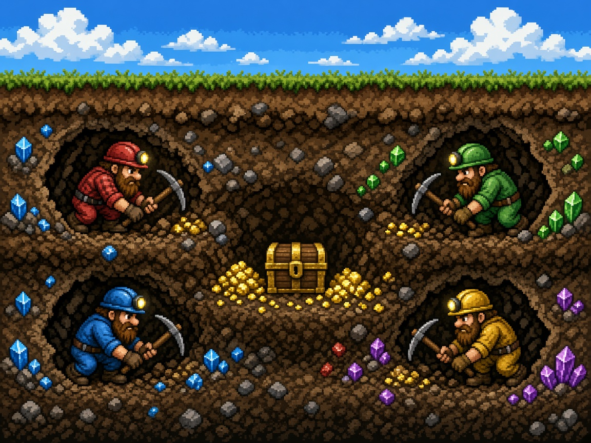

# Dig Wars

Four dwarves tunnel toward the center treasure and cave in anyone who gets there first. It is a 4-player local free-for-all on one shared screen: keyboard, gamepads, or a mix, with bots filling any empty slot so it is playable solo.

## Launch

The game is plain HTML5 and JavaScript. A tiny Python 3 server (no install, no network) opens it in your browser. Python 3 is the only dependency. If it is missing, the launcher tells you how to get it.

| Platform | One-click launcher |
| --- | --- |
| macOS | Double-click `launch-mac.command` |
| Windows | Double-click `launch-windows.bat` |
| Linux | Run `./launch-linux.sh` |

From a terminal, in this folder:

```bash
python3 server.py
```

The server binds to `127.0.0.1` on port **8803**. If that port is busy it tries the next free port, then opens the default browser. Pass `--no-browser` to start it without a window.

## Controls

Every dwarf can be remapped from the pause menu. Defaults:

| | Move | Action (cave-in) | Secondary (pick smash) |
| --- | --- | --- | --- |
| Ruby (P1) | W A S D | F | G |
| Teal (P2) | Arrow keys | `/` | `.` |
| Amber (P3) | I J K L | `;` | `'` |
| Violet (P4) | Numpad 8 4 5 6 | Numpad 0 | Numpad Enter |

P4 needs Num Lock on so the numpad keys stay numbers.

| Gamepad | Action |
| --- | --- |
| Left stick or d-pad | Move |
| A | Action (cave-in) |
| B | Secondary (pick smash) |
| Start | Pause |

Pads 0–3 map to P1–P4. A connected pad overrides that dwarf's keyboard and can be plugged in mid-match. The HUD shows a pad icon while it is connected. **Esc** pauses. **M** mutes. **Enter** or **Start** leaves the title and begins a match from the join screen.

On the join screen, press your action button to play that dwarf. Secondary toggles an empty slot between bot and off. At least one human or bot is required.

## Rules

- The mine is a grid of dirt and rock. Bedrock around the edge never breaks. Dirt digs quickly; rock takes longer.
- The four dwarves start in the four corners. The treasure sits in the center vault.
- Hold into a block to dig it. The secondary button is a pick smash: it breaks dirt in one hit and chips rock.
- Action plants a cave-in charge. After a short fuse it refills open tunnels in a radius. Dwarves standing in a tunnel that collapses are **buried** (eliminated until they respawn at their corner). Dwarves in the blast on a safe tile — a home pocket or the treasure vault — are **stunned** and drop the treasure. A shield power-up blocks one blast.
- Haste, shield, and blast-powder gems appear in the tunnels. Haste speeds movement and digging. Blast powder makes the next cave-in larger.
- Bots dig toward the treasure, carry it home, and cave in a rival who is carrying it.

## Scoring

Pick up the center treasure by walking onto it, then carry it back to your own corner. That wins the round. The first dwarf to **3** round wins takes the match. Settings can change the target to first to 1, 3, or 5. Standings are shown on the match-over screen, with rematch or a return to the title.

Being buried drops the treasure back in the vault. Being stunned drops it where you stand. You cannot score while stunned or buried, and you cannot score in someone else's corner.

## arcade.json

`arcade.json` is the Arcade OS manifest: display name, id `digwars`, icon, cover, per-platform launch commands, 4 players, minimum 1 player, keyboard and gamepad input, version `1.0.0`, and port `8803`.

## Tests

Core rules live in `src/core/` with no DOM and no canvas, so they run headlessly. Rendering, input devices, and audio live in `src/ui/`.

```bash
node --test tests/
python3 tests/smoke_server.py
```

Or both:

```bash
npm test
```

The JavaScript suite covers movement and collision, digging, cave-ins (bury, stun, shield), scoring, round and match wins, power-ups, bots, seeded RNG replays, keyboard and gamepad mapping, and `arcade.json`. The Python smoke test launches `server.py` without a browser, checks that it serves the game, and checks that a busy port 8803 falls forward to the next free port. GitHub Actions runs the same checks.

Randomness uses a seeded generator. The same seed and the same inputs replay the same match.

## License

MIT. See [LICENSE](LICENSE).
